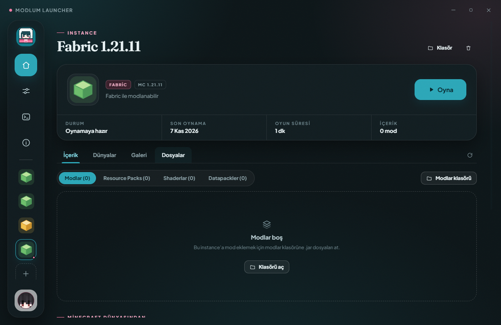
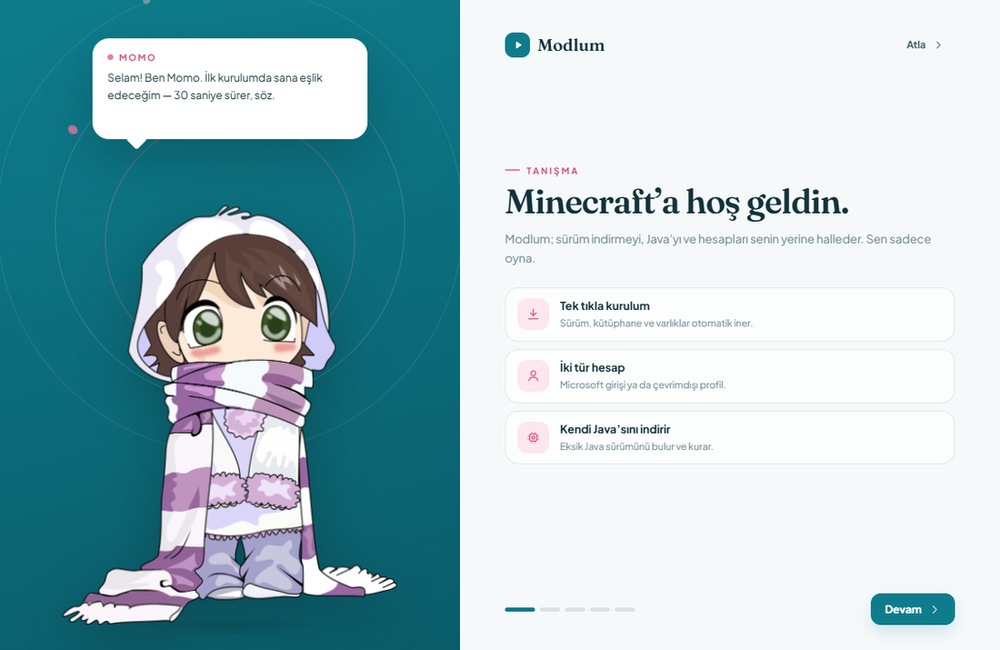
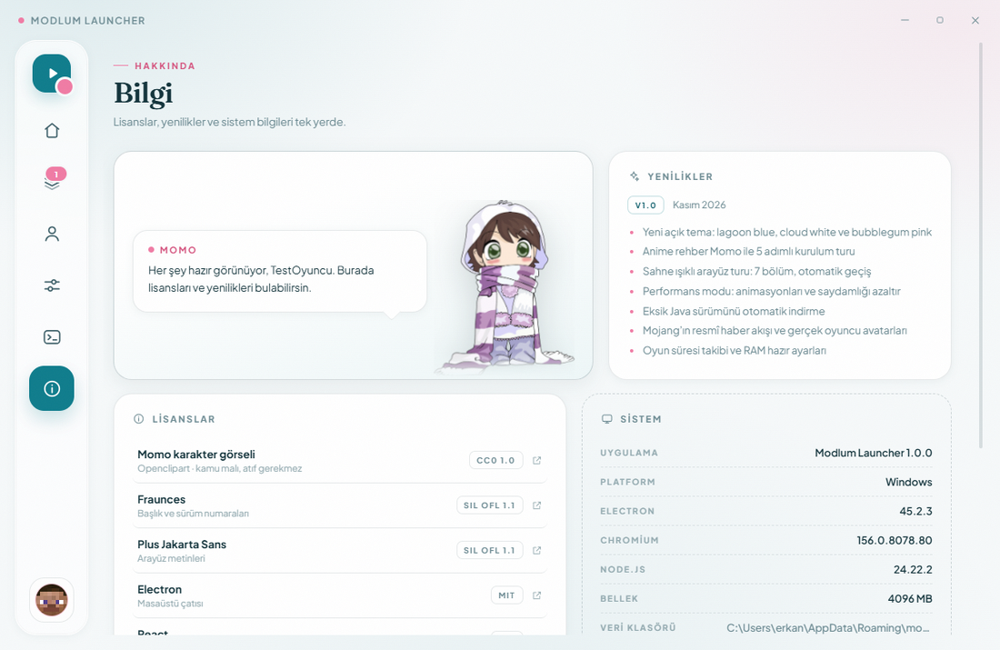

[](https://github.com/momo-y63/modlum-launcher/actions/workflows/build.yml)
[](https://github.com/momo-y63/modlum-launcher/releases)
[](LICENSE)

# Modlum Launcher

Windows için modern bir **Minecraft: Java Edition** başlatıcısı. Çekirdek **Rust (Tauri 2)**,
arayüz **React + TypeScript**; sürüm ve loader kurulumunu, Java'yı ve hesapları kullanıcının yerine halleder.



## Özellikler

- **Instance mimarisi** — her instance kendi Minecraft sürümünü, mod loader'ını, modlarını, dünyalarını
  ve ekran görüntülerini taşır. Sürüm/kütüphane/asset dosyaları ise tüm instance'lar arasında **tek kopya**
  olarak paylaşılır; aynı sürüm ikinci kez indirilmez.
- **Mod loader desteği** — Vanilla, Fabric, Quilt, Forge ve NeoForge ile instance oluşturma.
  (Fabric uçtan uca test edildi; diğerleri deneysel.)
- **Microsoft ve çevrimdışı hesap** — Microsoft için cihaz kodu (device code) akışı; istemci sırrı
  gerekmez. Çevrimdışı profiller tek oyunculu/çevrimdışı sunucular içindir.
- **Otomatik Java** — sürümün istediği Java yoksa Adoptium Temurin JRE otomatik indirilip kurulur.
- **Açık / koyu tema** — ilk açılışta Momo sorar; Ayarlar'dan değiştirilebilir.
- **Anime rehber Momo** — 6 adımlı kurulum turu ve sahne ışıklı arayüz turu (8 bölüm).
- **Performans modu** — animasyonları, bulanıklığı ve saydamlık efektlerini kapatır.
- **İçerik yönetimi** — modları aç/kapat, sil; resource pack, shader, datapack ve dünya klasörlerine erişim.
- **Mojang haber akışı**, oyun süresi takibi, gerçek oyuncu avatarları ve RAM hazır ayarları.
- **Spotify paneli** — arka planda çalan şarkıyı gör, parça değiştir, oynat/duraklat ve senkron sözleri takip et.
- **Türkçe arayüz**, açık kaynak ve MIT lisanslı.

| Kurulum turu | Bilgi / lisanslar |
|---|---|
|  |  |

## Gereksinimler

- **Windows 10/11 (x64)** ve **WebView2** (Windows 11'de kurulu gelir)
- Geliştirme için **Node.js ≥ 20**, **pnpm** ve **Rust** ([rustup](https://rustup.rs))
- Oyun için **Java**: Modern sürümler Java 21+ ister. Launcher eksik sürümü otomatik indirir.

## Kurulum (kullanıcı)

[Releases](https://github.com/momo-y63/modlum-launcher/releases) sayfasından `ModlumLauncher-*-Setup.exe` dosyasını indirip çalıştır.
Kurulum yönetici izni gerektirmez (per-user NSIS).

## Geliştirme

```bash
pnpm install
pnpm tauri dev    # Vite + Tauri geliştirme penceresi (HMR)
pnpm typecheck    # tsc --noEmit
pnpm build        # yalnızca arayüz derlemesi -> dist/
pnpm dist         # Windows kurulum paketi (NSIS)
```

## Paketleme

```bash
pnpm dist
```

Çıktı: `src-tauri/target/release/bundle/nsis/Modlum Launcher_<sürüm>_x64-setup.exe`.
CI bu dosyayı `ModlumLauncher-<sürüm>-Setup.exe` adıyla release'e ekler.

## Veri yerleşimi

| Ne | Nerede |
|---|---|
| Ayarlar | `%APPDATA%\modlum-launcher\settings.json` |
| Ortak sürümler / kütüphaneler / asset'ler | `%APPDATA%\.modlum\` |
| Instance'lar | `%APPDATA%\modlum-launcher\instances\<id>\` |
| Java runtime (otomatik) | `%APPDATA%\modlum-launcher\runtime\` |

Her instance klasörü: `mods/`, `saves/`, `screenshots/`, `resourcepacks/`, `shaderpacks/`, `datapacks/`.
Ortak veri klasörü Ayarlar'dan değiştirilebilir. Ayarlar dosyası Electron sürümüyle aynı biçimde
tutulduğu için mevcut kurulumlar olduğu gibi çalışmaya devam eder.

## Proje yapısı

```
src-tauri/            Rust çekirdeği (Tauri 2)
  src/main.rs           windows_subsystem girişi
  src/lib.rs            Tauri kurulumu ve komut kaydı
  src/commands.rs       IPC komutları, instance yönetimi, oyun başlatma
  src/install.rs        Sürüm/kütüphane/asset indirme
  src/loaders.rs        Fabric, Quilt, Forge, NeoForge kurulumu
  src/merge.rs          inheritsFrom birleştirme
  src/launch.rs         Classpath ve JVM/game argümanları
  src/auth.rs           Microsoft cihaz kodu akışı
  src/spotify.rs        Spotify OAuth (PKCE), çalma kontrolü, sözler
  src/java.rs           Java tespiti + Adoptium indirme
  src/core_net.rs       HTTP, hash doğrulama, eşzamanlı indirme
  tauri.conf.json       Pencere + NSIS paketleme ayarları
src/
  renderer/    React arayüzü (sayfalar, bileşenler, stiller)
  shared/      Ortak TypeScript tipleri
```

## Loader desteği

| Loader | Durum |
|---|---|
| Vanilla | ✅ |
| Fabric | ✅ test edildi |
| Quilt | 🧪 deneysel |
| Forge | 🧪 deneysel |
| NeoForge | 🧪 deneysel |

Forge/NeoForge resmî installer ile kurulur; büyük sürümlerde uzun sürebilir. Sorun yaşarsan
Konsol sekmesindeki çıktıyla issue açabilirsin.

## Yasal / lisanslar

- **Kod:** MIT — bkz. [LICENSE](LICENSE)
- **Yazı tipleri:** Fraunces ve Plus Jakarta Sans, SIL Open Font License 1.1. Tam metin uygulama
  içinde **Bilgi → Lisanslar** bölümünde yer alır.
- **Momo karakter görseli:** Openclipart, **CC0 1.0** (kamu malı).
- **Minecraft:** "Minecraft" Mojang Studios'un tescilli markasıdır. Bu proje Mojang veya Microsoft
  ile bağlantılı değildir. Oyun dosyaları yalnızca resmî Mojang sunucularından indirilir.

## Yol haritası

- Forge / NeoForge / Quilt kurulumlarının uçtan uca testleri
- Modrinth / CurseForge üzerinden tek tıkla mod kurma
- Çoklu dil desteği
- Otomatik güncelleme

Katkılar açıktır; issue ve pull request'ler memnuniyetle karşılanır.
